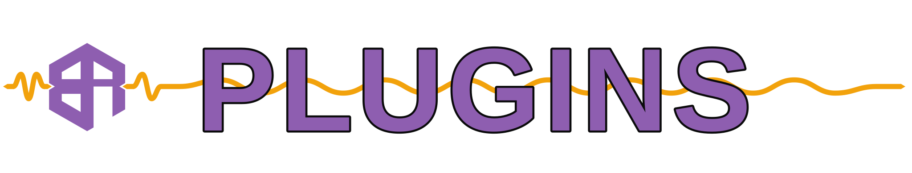

  

**Every Box Of Rules plugin, one download shelf.** Digitally Analogue: built from our own studio captures, real cabs, real mics, real rooms. You'll hear Box Of Rules plugins on Box Of Rules songs.

Each release here is one plugin at one version, tagged `<plugin>-v<version>`, with the installers for macOS, Windows and Linux attached. The plugin pages at [plugins.boxofrules.com](https://plugins.boxofrules.com?utm_source=github&utm_medium=readme&utm_campaign=plugins) link straight to these files and keep the docs, FAQ and presets beside them. Most of our plugins are free. The supporter ones say so on their page.

## Plugins

More arrive here as their releases move across from the older per-plugin repos.

### Box Of Synths

**BETA CLOSED: at capacity.** The free beta of Box Of Synths, the synth that designs the patch you type, filled its places in under a week. Thank you to everyone who joined. The official release, a free Box Of Synths and a Pro one, lands in early October (date to be confirmed). [Sign up for the newsletter at boxofsynths.com](https://boxofsynths.com/?utm_source=github&utm_medium=readme&utm_campaign=plugins#newsletter) and we email you the day it lands.

Already in the beta? The pre-release builds below stay up so you can reinstall, and codes still go to the address you signed up with. A new address gets no code now: the database answers only beta places.

[boxofsynths.com](https://boxofsynths.com?utm_source=github&utm_medium=readme&utm_campaign=plugins) · [Beta builds (0.3.x, pre-release)](https://github.com/boxofrules/plugins/releases?q=box-of-synths-free-v&expanded=true)

### Focus

Remove the peripherals: the stereo sides close in, the mono middle comes forward. A Goghini and Box Of Rules collaboration. Free. AU, VST3, LV2 and AAX for macOS, Windows and Linux.

[Plugin page, docs and FAQ](https://plugins.boxofrules.com/plugins/focus?utm_source=github&utm_medium=readme&utm_campaign=plugins) · [Latest release: 1.0.1](https://github.com/boxofrules/plugins/releases/tag/focus-v1.0.1) · [All Focus releases](https://github.com/boxofrules/plugins/releases?q=focus-v&expanded=true)

## Links

- Plugin pages, docs and presets: [plugins.boxofrules.com](https://plugins.boxofrules.com?utm_source=github&utm_medium=readme&utm_campaign=plugins)
- The music: [boxofrules.com](https://boxofrules.com?utm_source=github&utm_medium=readme&utm_campaign=plugins)
- Keep it coming: [boxofrules.com/support](https://boxofrules.com/support?utm_source=github&utm_medium=readme&utm_campaign=plugins)
